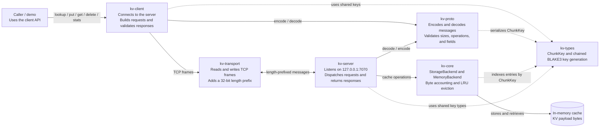

# kvstash architecture

The workspace is split into crates by responsibility. The client and server
share the protocol and transport layers, while the server owns the cache
backend. `kv-types` supplies shared cache-key types and key-generation
functions.

## Component diagram

## Component responsibilities

| Component | Responsibilities |
| --- | --- |
| Caller / demo | Calls the client API. The example demonstrates prefix lookup and cache operations; it does not run model inference. |
| `kv-client` | Opens a TCP connection, assigns request IDs, sends one request at a time, checks response IDs and types, and exposes lookup, put, get, delete, and stats methods. |
| `kv-transport` | Provides async frame I/O over Tokio streams. Each frame has a big-endian 32-bit length followed by a message body; partial or invalid frames are errors. |
| `kv-proto` | Defines request/response message types and their binary codec. Enforces frame and batch limits and rejects malformed or trailing data. |
| `kv-server` | Listens on loopback port `7070`, shares the cache across connection tasks, routes decoded requests to storage, and sends encoded responses. Requests on each connection are handled sequentially. |
| `kv-core` | Defines the storage interface and in-memory implementation. Tracks payload-byte usage, updates LRU recency, evicts entries to honor the configured byte budget, and reports storage errors. |
| `kv-types` | Defines the 16-byte `ChunkKey` and generates chained, model-fingerprint-aware keys for token chunks. |
| In-memory cache | Holds the actual opaque payload bytes indexed by `ChunkKey`; it does not interpret KV tensors or persist entries to disk. |

## Workspace crates and dependency order

The workspace is organized so lower-level crates can be built and tested
before the crates that use them:

| Crate | Workspace crate dependencies | Build/test command |
| --- | --- | --- |
| `kv-types` | None | `cargo test -p kv-types` |
| `kv-core` | `kv-types` | `cargo test -p kv-core` |
| `kv-proto` | `kv-types` | `cargo test -p kv-proto` |
| `kv-transport` | `kv-proto` | `cargo test -p kv-transport` |
| `kv-server` | `kv-core`, `kv-proto`, `kv-transport`, `kv-types` | `cargo test -p kv-server` |
| `kv-client` | `kv-proto`, `kv-transport`, `kv-types` | `cargo test -p kv-client` |

`kv-core` and `kv-proto` can be developed independently after `kv-types`.
`kv-transport` builds on `kv-proto`; the server and client sit at the top of
the dependency graph. Run `cargo test --workspace` to verify all crates
together.

## Request flow

For a prefix lookup, the path through the system is:

1. The caller asks `kv-client` to look up an ordered list of `ChunkKey`s.
2. The client creates a request with an ID; `kv-proto` encodes it.
3. `kv-transport` writes a length-prefixed frame to the TCP connection.
4. `kv-server` reads and decodes the frame, then checks the keys in `kv-core`.
   It counts only the consecutive hits from the start of the list.
5. The server encodes a response with the same request ID and writes it back.
6. The client reads the frame, validates the response ID and type, and returns
   the hit count.

`PUT`, `GET`, `DELETE`, and `STATS` follow the same framing and encoding path,
with the server dispatching each operation to the corresponding storage
methods.

## Current boundaries

- The storage backend is in-memory only; restarting the server discards entries.
- The server binds to `127.0.0.1:7070` by default.
- The client processes one in-flight request per connection; request IDs do not
  currently enable multiplexing.
- The project stores opaque payload bytes and generates cache keys; it does not
  compute transformer KV tensors.
